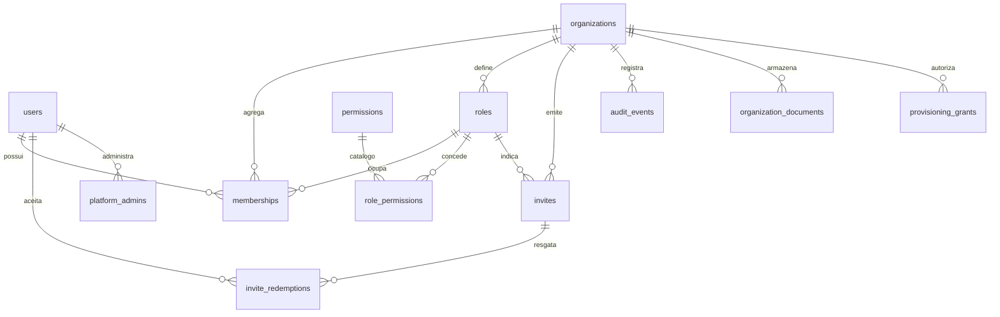

# Modelo de domínio — organizações, cargos, permissões e convites

**Status:** aprovado para implementação em 27/10/2026. As decisões da seção 8.1 estão confirmadas; as da seção 8.2 permanecem pendentes.

Este documento registra o modelo aprovado e as decisões ainda abertas. Ele **não substitui** [regras-de-negocio.md](regras-de-negocio.md); onde houver divergência, prevalecem as regras de negócio e a decisão explícita do responsável pelo produto.

## 1. Objetivo

Modelar a entrada de associações na plataforma, a configuração inicial, os vínculos entre pessoas e organizações, os cargos, o catálogo de permissões e os convites, preservando:

- identidade global por CPF;
- isolamento entre organizações;
- autorização calculada no servidor a partir do estado atual;
- histórico de vínculos e intervenções;
- distinção entre administração da plataforma e cargos da associação.

## 2. O que já está confirmado

Resumo das regras existentes que este modelo precisa respeitar:

- A organização começa em `PROVISIONING` e só se torna operacional após cumprir os requisitos de ativação.
- CNPJ é validado externamente e não pode duplicar organizações.
- Cada vínculo ativo possui exatamente um cargo atual da mesma organização.
- Cargos definem permissões; permissões não são atribuídas diretamente a pessoas ou vínculos.
- Ser de diretoria e ter acesso completo são propriedades independentes.
- Um cargo de acesso completo possui todas as permissões configuráveis atuais e futuras, mas não ignora isolamento, propriedade, estados ou invariantes.
- Um convite individual é vinculado ao CPF e pode indicar cargo de diretoria ou acesso completo.
- Um convite compartilhado é reutilizável, pode ter limite de usos e não pode conceder diretoria nem acesso completo.
- O uso do convite é consumido na ativação efetiva do vínculo, não ao abrir o link.
- Vínculos são preservados e reutilizados em reativações.
- A organização não pode ficar sem membros ativos com acesso completo.
- A administração da plataforma é uma autoridade distinta e deve ser auditada.

## 3. Proposta de entidades

### 3.1 Visão geral

### 3.2 `organizations`

Representa a associação. A identidade global da pessoa continua em `users`; a organização é o limite de isolamento.

Campos propostos:

- `id` uuid, chave primária.
- `cnpj` varchar(14), apenas dígitos, único e obrigatório.
- `legal_name` varchar(255), obtida na consulta externa do CNPJ.
- `acronym` varchar(32), ajustável pela organização.
- `status` enum `provisioning | active`, iniciando em `provisioning`.
- `cnpj_verified_at` timestamptz, evidência da validação externa.
- `created_by_user_id` uuid, referência a `users`, para auditoria.
- `activated_at` timestamptz, preenchido na ativação.
- `created_at` e `updated_at` timestamptz.

Observações:

- `cnpj` deve ser normalizado antes de persistir.
- A razão social vem da consulta; a sigla é editável.
- O status `active` não deve ser revertido para `provisioning` sem uma decisão específica.

### 3.3 `roles`

Cargo definido por cada organização.

Campos propostos:

- `id` uuid, chave primária.
- `organization_id` uuid, obrigatório.
- `name` varchar(100), nome definido pela organização.
- `is_director` boolean, indica diretoria.
- `has_full_access` boolean, indica acesso completo.
- `is_default` boolean, indica o cargo padrão de ingresso.
- `is_active` boolean, permitindo desativar sem apagar histórico.
- `created_at` e `updated_at` timestamptz.

Restrições propostas:

- `unique (organization_id, name)`.
- No máximo um cargo ativo com `is_default = true` por organização, via índice parcial.
- O cargo padrão não pode ser de diretoria nem de acesso completo.
- Um cargo não deve ser excluído enquanto houver vínculo ou convite que o referencie; a desativação preserva o histórico.
- O cargo de acesso completo não precisa receber uma linha em `role_permissions` para cada permissão: a autorização verifica `has_full_access` primeiro e, depois, as permissões explícitas. Isso cobre permissões futuras.

### 3.4 `permissions`

Catálogo global da plataforma, com códigos estáveis.

Campos propostos:

- `code` varchar(100), chave primária. Exemplos: `members.read`, `members.invite`, `roles.manage`, `organization.settings`.
- `description` varchar(255).
- `category` varchar(50).

O catálogo pertence à plataforma, não à organização. Novas permissões devem ser aditivas e versionadas.

### 3.5 `role_permissions`

Associação entre cargo e permissão.

- `role_id` uuid, referência a `roles`.
- `permission_code` varchar(100), referência a `permissions`.
- Chave primária composta por ambos.

Não existe tabela de permissões por usuário ou por vínculo.

### 3.6 `memberships`

Vínculo entre uma pessoa e uma organização.

Campos propostos:

- `id` uuid, chave primária.
- `organization_id` uuid, obrigatório.
- `user_id` uuid, obrigatório.
- `role_id` uuid, obrigatório.
- `status` enum `active | inactive`.
- `joined_at` timestamptz.
- `deactivated_at` timestamptz.
- `deactivated_by_user_id` uuid.
- `deactivation_reason` text.
- `created_at` e `updated_at` timestamptz.

Restrições propostas:

- `unique (organization_id, user_id)`: uma pessoa tem no máximo um vínculo por organização, reutilizado em reativações.
- O cargo deve pertencer à mesma organização. A forma mais segura é uma chave estrangeira composta `(role_id, organization_id)` apontando para `roles (id, organization_id)`.
- O vínculo inativo permanece no banco com seu histórico e não concede acesso.
- O vínculo ativo deve ter exatamente um cargo atual.

### 3.7 `invites`

Convite individual ou compartilhado.

Campos propostos:

- `id` uuid, chave primária.
- `organization_id` uuid, obrigatório.
- `role_id` uuid, obrigatório.
- `type` enum `individual | shared`.
- `document_number` varchar(11), obrigatório para convite individual e nulo para compartilhado.
- `token_hash` varchar(64), único, nunca o token em texto claro.
- `max_uses` integer, nulo para uso ilimitado ou limitado conforme decisão.
- `uses_count` integer, iniciando em zero.
- `expires_at` timestamptz.
- `revoked_at` timestamptz.
- `created_by_membership_id` uuid.
- `created_at` timestamptz.

Regras de aplicação:

- Convite individual só pode ser aceito pela identidade com o CPF correspondente.
- Convite compartilhado não pode apontar para cargo de diretoria nem de acesso completo.
- Sem cargo indicado, o convite compartilhado usa o cargo padrão de ingresso.
- Abrir o link ou solicitar email não incrementa `uses_count`.
- A ativação efetiva do vínculo incrementa `uses_count` e registra o resgate.
- A revalidação do convite deve ocorrer na conclusão, sob bloqueio.

### 3.8 `invite_redemptions`

Histórico de ativações por convite.

- `id` uuid.
- `invite_id` uuid.
- `user_id` uuid.
- `membership_id` uuid.
- `redeemed_at` timestamptz.

Esse histórico permite auditar convites compartilhados e reativações. Um mesmo usuário pode ter mais de um resgate ao longo do tempo, por exemplo após desativação e reativação.

### 3.9 `provisioning_grants`

Acesso temporário de configuração durante `PROVISIONING`.

- `id` uuid.
- `organization_id` uuid.
- `user_id` uuid.
- `created_by_user_id` uuid.
- `created_at` timestamptz.
- `revoked_at` timestamptz.

Propriedades:

- Não é vínculo permanente nem cargo.
- Não concede acesso completo fora do estado `provisioning`.
- Deve deixar de valer automaticamente quando a organização for ativada.
- A concessão é criada para o CPF indicado pelo administrador da plataforma e deixa de valer na ativação.

### 3.10 `organization_documents`

Documentos institucionais do fluxo de configuração.

- `id` uuid.
- `organization_id` uuid.
- `type` enum `statute | election_minutes` (expansível).
- `storage_key` text.
- `uploaded_by_user_id` uuid.
- `created_at` timestamptz.

A obrigatoriedade de cada documento para ativação ainda precisa ser confirmada. O armazenamento físico dos arquivos também precisa de decisão.

### 3.11 `platform_admins`

Autoridade separada dos cargos de associação.

- `user_id` uuid, chave primária.
- `granted_by_user_id` uuid.
- `created_at` timestamptz.
- `revoked_at` timestamptz.

Inicialmente, apenas o responsável pelo aplicativo. Intervenções devem gerar evento de auditoria. Essa autoridade não concede acesso implícito a dados ou operações internas da organização; os poderes são apenas os registrados em 8.1.

### 3.12 `audit_events`

Registro append-only de ações relevantes.

- `id` uuid.
- `actor_user_id` uuid.
- `organization_id` uuid, quando aplicável.
- `action` varchar(100).
- `entity_type` varchar(50).
- `entity_id` uuid.
- `metadata` jsonb, sem credenciais ou dados sensíveis desnecessários.
- `created_at` timestamptz.

Eventos mínimos: criação de organização, ativação, alteração de cargo, alteração de permissões, convite criado/revogado, vínculo ativado/desativado, intervenção da plataforma.

### 3.13 Pré-cadastro de pessoa

A regra confirma que `users` pode existir sem `accounts`, mas não define uma tabela específica para o pré-cadastro. Duas alternativas:

1. Reutilizar `registration_requests`, adicionando `organization_id` e `created_by_user_id` para links gerados por operador. O `userId` já existente aponta para a pessoa pré-cadastrada.
2. Criar uma tabela `pre_registrations` separada, com `organization_id`, `user_id`, `created_by_membership_id`, `contact_email` e `converted_at`.

A primeira opção foi adotada: `registration_requests` recebe `organization_id`, `role_id` e `created_by_user_id`, reaproveitando o token e a confirmação já implementados. O operador escolhe o cargo inicial e a ativação cria o vínculo. Contatos divergentes são registrados em `registration_contact_conflicts` e o titular escolhe o contato ao concluir a conta.

## 4. Invariantes e verificações

### 4.1 Ativação da organização

Antes de mudar `status` para `active`, verificar em uma transação:

- existe exatamente um cargo ativo padrão de ingresso, sem diretoria e sem acesso completo;
- existe pelo menos um cargo ativo com acesso completo;
- cada cargo ativo de diretoria tem ocupante ativo ou convite individual válido;
- existe pelo menos um vínculo ativo com cargo ativo de acesso completo;
- os requisitos documentais definidos forem cumpridos.

### 4.2 Operação

- A organização ativa não pode perder o último membro ativo com acesso completo. A operação deve ser bloqueada até existir um sucessor ativo.
- Toda operação deve validar: identidade autenticada, organização de destino, vínculo ativo, cargo e permissão, propriedade do recurso, estado e invariantes.
- O servidor é a autoridade; `organizationId` enviado pelo cliente não comprova acesso.
- Mudanças de cargo ou permissão valem imediatamente nas verificações seguintes, sem novo login.

### 4.3 Convites e vínculos

- Convite individual não pode ser aceito por outra pessoa.
- Convite compartilhado não pode conceder diretoria ou acesso completo.
- Vínculo ativo existente não é duplicado nem muda de cargo ao aceitar convite.
- Vínculo inativo é reutilizado; a reativação consome uso do convite compartilhado.
- O consumo ocorre apenas na ativação efetiva.
- Convite expirado ou revogado permanece no histórico.

## 5. Fluxos principais

### 5.1 Criação pelo presidente

1. Presidente autenticado informa o CNPJ.
2. Plataforma valida o CNPJ externamente e verifica duplicidade.
3. Organização é criada em `PROVISIONING`.
4. Sistema sugere incluir o criador como presidente com acesso completo.
5. Configuração de cargos, diretoria, documentos e convites.
6. Ativação quando os invariantes forem satisfeitos.
7. Acesso temporário de configuração termina.

### 5.2 Criação pelo administrador da plataforma

1. Administrador cria a organização com dados básicos.
2. A organização fica em `PROVISIONING`.
3. Alguém da diretoria precisa concluir a configuração.
4. A forma de conceder esse acesso continua pendente.

### 5.3 Convite individual

1. Pessoa autorizada cria o convite vinculado ao CPF e ao cargo.
2. Destinatário confirma o email e cria ou reutiliza a conta.
3. Ao aceitar, a identidade é comparada com o CPF do convite.
4. Vínculo é criado ou reativado.
5. Uso e resgate são registrados.

### 5.4 Convite compartilhado

1. Pessoa autorizada cria o convite com cargo permitido e limite opcional de usos.
2. Destinatário cria a conta, se necessário.
3. Na ativação, o convite é revalidado e o uso é consumido.
4. Se a pessoa já for membro ativo, nada muda e nenhum uso é consumido.

## 6. Autorização

A verificação deve ser centralizada em uma camada de servidor, não apenas nas Server Actions.

Entrada mínima:

- usuário autenticado;
- organização de destino;
- recurso e operação;
- vínculo ativo do usuário;
- cargo do vínculo e permissões;
- propriedade do recurso, quando aplicável;
- estado da organização e do recurso;
- invariantes de negócio.

Regras de decisão:

- acesso completo concede todas as permissões configuráveis, mas não ignora isolamento, propriedade, estados ou invariantes;
- permissões explícitas são verificadas no cargo atual;
- administração da plataforma é verificada separadamente e auditada;
- acesso temporário de configuração só vale durante `PROVISIONING`.

## 7. Fases sugeridas de implementação

### Fase A — Núcleo organizacional

- `organizations`, `roles`, `permissions`, `role_permissions`, `memberships`, `platform_admins`, `audit_events`.
- Criação de organização, configuração inicial e ativação.
- Verificação de isolamento e permissões.
- Testes de invariantes.

### Fase B — Convites e pré-cadastro

- `invites`, `invite_redemptions`.
- Fluxo individual e compartilhado.
- Reutilização de vínculo inativo.
- Extensão do mecanismo de confirmação para pré-cadastro por operador.

### Fase C — Provisionamento e documentos

- `provisioning_grants`, `organization_documents`.
- Acesso temporário de configuração.
- Upload e validação de estatuto e ata.
- Definição do acesso da diretoria quando a organização é iniciada pela plataforma.

### Fase D — Painel administrativo

- Interface da plataforma.
- Auditoria visível.
- Limites de poder definidos.

## 8. Decisões

### 8.1 Confirmadas

1. O CNPJ é consultado na BrasilAPI para obter a razão social e confirmar sua existência. Enquanto o vínculo CPF/CNPJ não estiver comprovado por fonte confiável, o administrador da plataforma valida a ata de eleição para reconhecer a autoridade do presidente.
2. Quando o administrador da plataforma inicia uma organização, ele indica um CPF para receber uma concessão temporária de configuração. A concessão não é vínculo nem acesso completo e termina com a ativação.
3. Contatos divergentes em perfis globais sem conta não são sobrescritos automaticamente. A divergência é registrada para o titular resolver ao assumir a conta.
4. O pré-cadastro por operador reutiliza `registration_requests` com organização, cargo e operador; o operador escolhe o cargo inicial e a ativação cria o vínculo.
5. O titular escolhe o contato a manter ao concluir a conta; a escolha encerra as divergências registradas.
6. Convites individuais expiram em 7 dias e têm 1 uso; compartilhados expiram em 30 dias com limite definido pelo operador. O reenvio invalida o link anterior e respeita 60 segundos.
7. O administrador da plataforma pode criar organização com dados básicos, analisar solicitações (consultar a ata e aprovar ou rejeitar com motivo) e listar organizações. Não acessa membros, convites, cargos, configurações, auditoria ou outras operações internas sem vínculo ativo; não ativa organização, não altera vínculos, não exclui organização e não se passa por usuário. Intervenções são auditadas e novos poderes exigem decisão explícita.

### 8.2 Pendentes

Estas decisões bloqueiam partes do modelo e não devem ser resolvidas por suposição:

1. O que acontece com um cargo desativado que ainda possui vínculos ou convites?
2. Estatuto e ata são obrigatórios para ativação? Onde os arquivos serão armazenados?
3. Quais critérios de elegibilidade do CNPJ serão aplicados (por exemplo, CNAE de associação)?
4. O status da organização precisa de estados adicionais além de `provisioning` e `active`?
5. Qual é o formato de auditoria exigido para intervenções da plataforma?

## 9. Riscos e cuidados

- Não importar o modelo do repositório antigo sem decisão explícita.
- Não permitir que a interface esconda uma verificação de autorização ausente no servidor.
- Não conceder permissões diretamente a `users` ou `memberships`.
- Não usar o nome do cargo como prova de autoridade.
- Não deixar a organização ativa sem sucessor de acesso completo.
- Não consumir convite ao abrir o link.
- Não duplicar vínculos em reativações.
- Não expor tokens de convite em logs, URLs de análise ou histórico do navegador.
- Não tratar a administração da plataforma como um cargo de associação.
